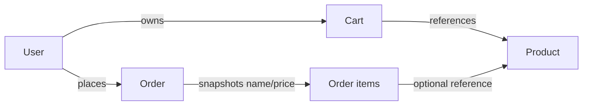

# Lesson 74 — Products, Cart and Orders Modeling

[← Section 8](./README.md) · [Full curriculum](../README.md)

## 1. Why an e-commerce data model is difficult

A product's current price may change tomorrow, but a customer's order from yesterday must still show the **price paid yesterday**. A cart is editable; an order is a historical business record. Inventory is shared by many buyers; a naive read-then-save can oversell stock. The model must represent these different lifecycles explicitly.

## 2. Start with access patterns

- Browse active products by category and price.
- Read and modify one user's current cart.
- Checkout a cart while ensuring sufficient stock.
- Read an order and its historical item prices.
- List a user's orders newest first.
- Aggregate sales for an admin dashboard.

Model for these queries and update patterns rather than copying relational tables mechanically.

## 3. Four core entities

| Entity | Data | Why |
| --- | --- | --- |
| Product | SKU, current price, stock, active | Mutable catalog |
| User | Account and credentials | Identity and owner |
| Cart | userId and embedded items | Bounded editable selection |
| Order | userId, immutable item snapshots, totals, status | Historical purchase record |



## 4. Product model

```js
import mongoose from "mongoose";
const { Schema } = mongoose;

const productSchema = new Schema({
  sku: { type: String, required: true, trim: true, uppercase: true },
  name: { type: String, required: true, trim: true },
  priceMinor: { type: Number, required: true, min: 0 },
  stock: { type: Number, required: true, min: 0 },
  active: { type: Boolean, default: true }
}, { timestamps: true });

productSchema.index({ sku: 1 }, { unique: true });
const Product = mongoose.model("Product", productSchema);
```

Money is stored in **integer minor units**, e.g. 49900 paise for ₹499. A Number remains limited by JavaScript safe-integer bounds; use a deliberate Decimal128/BigInt-compatible strategy for larger or fractional monetary domains.

## 5. Cart: bounded embedded items

```js
const cartItemSchema = new Schema({
  productId: { type: Schema.Types.ObjectId, ref: "Product", required: true },
  quantity: { type: Number, required: true, min: 1 }
}, { _id: false });

const cartSchema = new Schema({
  userId: { type: Schema.Types.ObjectId, ref: "User", required: true },
  items: { type: [cartItemSchema], default: [] }
}, { timestamps: true });

cartSchema.index({ userId: 1 }, { unique: true });
const Cart = mongoose.model("Cart", cartSchema);
```

One cart per user is enforced by a unique index. Cart items reference products, but do **not** trust a price copied from the browser. Re-read current product prices and availability at checkout. Limit cart item count and quantities; unbounded embedded arrays can grow beyond MongoDB's 16 MiB document limit.

## 6. Order: snapshot prices and product names

```js
const orderItemSchema = new Schema({
  productId: { type: Schema.Types.ObjectId, ref: "Product", required: true },
  sku: { type: String, required: true },
  name: { type: String, required: true },
  quantity: { type: Number, required: true, min: 1 },
  unitPriceMinor: { type: Number, required: true, min: 0 },
  lineTotalMinor: { type: Number, required: true, min: 0 }
}, { _id: false });

const orderSchema = new Schema({
  userId: { type: Schema.Types.ObjectId, ref: "User", required: true },
  items: { type: [orderItemSchema], required: true },
  totalMinor: { type: Number, required: true, min: 0 },
  status: {
    type: String,
    enum: ["PENDING", "PAID", "CANCELLED", "FULFILLED"],
    default: "PENDING"
  }
}, { timestamps: true });

orderSchema.index({ userId: 1, createdAt: -1 });
const Order = mongoose.model("Order", orderSchema);
```

**Why embed snapshots?** A later product rename, deletion or price change must not rewrite historical order facts. `productId` still allows optional navigation to the current product, but the snapshot remains authoritative for that order's display and accounting.

## 7. A naive checkout that fails

```js
// BAD: two concurrent checkouts can both read stock = 1
const product = await Product.findById(productId);
if (product.stock >= 1) {
  product.stock -= 1;
  await product.save();
}
```

Two buyers may read the same stock before either saves. Without appropriate concurrency controls, overselling or lost updates can occur.

## 8. Atomic inventory reservation

```js
const updated = await Product.findOneAndUpdate(
  { _id: productId, active: true, stock: { $gte: quantity } },
  { $inc: { stock: -quantity } },
  { new: true }
);
if (!updated) throw new Error("Out of stock or unavailable");
```

The condition and decrement execute atomically on **one product document**. This protects the individual stock decrement, but **not** the complete checkout across several products and the order document.

## 9. Multi-document checkout with a transaction

```js
async function checkout(userId, cart) {
  if (!cart.items.length) throw new Error("Cart is empty");

  return mongoose.connection.transaction(async session => {
    const snapshots = [];

    for (const item of cart.items) {
      if (!Number.isSafeInteger(item.quantity) || item.quantity < 1) {
        throw new Error("Invalid quantity");
      }

      const product = await Product.findOneAndUpdate(
        {
          _id: item.productId,
          active: true,
          stock: { $gte: item.quantity }
        },
        { $inc: { stock: -item.quantity } },
        { new: true, session }
      );
      if (!product) throw new Error("Insufficient stock");

      const lineTotalMinor = product.priceMinor * item.quantity;
      if (!Number.isSafeInteger(lineTotalMinor)) {
        throw new Error("Amount overflow");
      }
      snapshots.push({
        productId: product._id, sku: product.sku, name: product.name,
        quantity: item.quantity,
        unitPriceMinor: product.priceMinor, lineTotalMinor
      });
    }

    const totalMinor = snapshots.reduce((sum, item) => sum + item.lineTotalMinor, 0);
    if (!Number.isSafeInteger(totalMinor)) throw new Error("Amount overflow");

    const [order] = await Order.create(
      [{ userId, items: snapshots, totalMinor, status: "PENDING" }],
      { session }
    );

    return order;
  });
}
```

**Important:** This is a **transaction demonstration**, not a complete production checkout. It does not clear the cart, deduplicate duplicate product lines, collect payment, implement idempotency, handle taxes/shipping, or prevent repeated checkout of the same cart. Those requirements need explicit design. A production transaction should atomically record the intended cart/order transition and use an idempotency key. Payment calls should happen outside a retryable transaction callback with a robust workflow/outbox.

Transactions require a replica set or sharded deployment. Do not use `Promise.all` inside a transaction; keep the operations sequential and short.

## 10. State transitions and authorization

A user can cancel a **PENDING** order but should not set `PAID` directly. Payment state changes should come from trusted server-side payment verification or verified webhooks. Model allowed transitions, for example PENDING → PAID → FULFILLED, with cancellation/refund branches. Use conditional atomic updates so two actors cannot both transition from a stale state.

## 11. Indexes and deletion policies

`Cart.userId` is unique; `Order({userId,createdAt:-1})` supports order history. Product SKU should be unique. Soft-delete products rather than breaking historical orders. Consider retaining product snapshots even if the referenced product is later deleted.

## 12. Exercises and interview review

Model a cart with two items, compute order snapshots, change the product's current price and verify the old order total remains unchanged. Simulate stock = 1 and two concurrent buyers. Explain **embedding vs referencing**, **why a stock decrement must be atomic**, and **why a multi-document checkout needs stronger consistency controls**.

**References:** [MongoDB data modeling](https://www.mongodb.com/docs/manual/data-modeling/) · [MongoDB transactions](https://www.mongodb.com/docs/manual/core/transactions/) · [Mongoose transactions](https://mongoosejs.com/docs/transactions.html)
