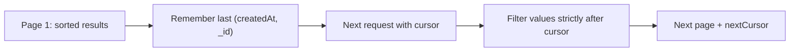

# Lesson 75 — Filtering, Sorting and Cursor Pagination API

[← Section 8](./README.md) · [Full curriculum](../README.md)

## 1. The problem: listing thousands of products

A catalog may have millions of products. Returning all of them wastes database time, network bandwidth, memory and browser rendering time. A listing endpoint needs **filtering**, **sorting** and **pagination**. These are related but different: filter decides *which* records, sort decides *what order*, pagination decides *which slice*.

## 2. Never pass req.query directly to MongoDB

```js
// BAD: arbitrary user-controlled filter/operators
const products = await Product.find(req.query);
```

HTTP query parameters are strings and may contain unexpected keys. Passing them directly to a MongoDB filter risks operator injection, excessive queries, and accidental exposure. Define an explicit allowlist and validate each value.

## 3. Define a query contract with Zod

```js
import { z } from "zod";

const listQuerySchema = z.strictObject({
  category: z.enum(["BOOKS", "ELECTRONICS"]).optional(),
  minPriceMinor: z.coerce.number().int().nonnegative().optional(),
  maxPriceMinor: z.coerce.number().int().nonnegative().optional(),
  sort: z.enum(["newest", "priceAsc", "priceDesc"]).default("newest"),
  limit: z.coerce.number().int().min(1).max(50).default(20),
  cursor: z.string().optional()
}).refine(
  q => q.minPriceMinor === undefined ||
       q.maxPriceMinor === undefined ||
       q.minPriceMinor <= q.maxPriceMinor,
  "minPriceMinor must not exceed maxPriceMinor"
);
```

Add `category` to the Product model if using this example. Be aware that coercion can accept surprising values (e.g. empty strings); for strict public APIs, validate the original string format before numeric conversion.

## 4. Build a safe filter

```js
function productFilter(q) {
  const filter = { active: true };
  if (q.category) filter.category = q.category;

  if (q.minPriceMinor !== undefined || q.maxPriceMinor !== undefined) {
    filter.priceMinor = {};
    if (q.minPriceMinor !== undefined) filter.priceMinor.$gte = q.minPriceMinor;
    if (q.maxPriceMinor !== undefined) filter.priceMinor.$lte = q.maxPriceMinor;
  }
  return filter;
}
```

`$gte` means greater than or equal, `$lte` less than or equal. All operators here are constructed by **trusted server code**, not accepted from the user.

## 5. Offset pagination: simple but imperfect

```js
const page = 3, limit = 20;
const products = await Product.find({ active: true })
  .sort({ createdAt: -1, _id: -1 })
  .skip((page - 1) * limit)
  .limit(limit)
  .lean();
```

This skips 40 documents and returns up to 20. It is easy to implement, but deep offsets may require MongoDB to scan past many records. If new products are inserted between requests, pages may shift, causing duplicates or omissions.

## 6. Cursor/keyset pagination: the conceptual solution

Instead of saying “skip the first 20,000 records,” say “continue **after the last record I saw**.” For newest-first order, use a stable sort `{createdAt:-1,_id:-1}`. The `_id` tie-breaker makes ordering deterministic when several products share the same timestamp.

A cursor should encode the last item's **sort values**, not merely a page number. In production, sign cursors or otherwise prevent tampering and bind them to the selected filter/sort.

## 7. Working newest-first cursor example

```js
function encodeCursor(doc) {
  return Buffer.from(JSON.stringify({
    createdAt: doc.createdAt.toISOString(),
    id: doc._id.toString()
  })).toString("base64url");
}

function decodeCursor(raw) {
  try {
    const value = JSON.parse(Buffer.from(raw, "base64url").toString("utf8"));
    if (typeof value.createdAt !== "string" ||
        !Number.isFinite(Date.parse(value.createdAt)) ||
        !/^[a-fA-F0-9]{24}$/.test(value.id)) {
      throw new Error("Invalid cursor");
    }
    return { createdAt: new Date(value.createdAt), id: new mongoose.Types.ObjectId(value.id) };
  } catch {
    throw new Error("Invalid cursor");
  }
}

async function listNewestProducts({ limit = 20, cursor } = {}) {
  const filter = { active: true };

  if (cursor) {
    const last = decodeCursor(cursor);
    filter.$or = [
      { createdAt: { $lt: last.createdAt } },
      { createdAt: last.createdAt, _id: { $lt: last.id } }
    ];
  }

  const rows = await Product.find(filter)
    .select("name sku priceMinor createdAt")
    .sort({ createdAt: -1, _id: -1 })
    .limit(limit + 1)
    .lean();

  const hasNextPage = rows.length > limit;
  const page = rows.slice(0, limit);
  return {
    data: page,
    nextCursor: hasNextPage ? encodeCursor(page[page.length - 1]) : null
  };
}
```

The extra record answers whether another page exists. This example intentionally implements **newest-first only**. The `priceAsc` and `priceDesc` sort modes in the earlier contract require their own cursor encoding and predicates using `priceMinor` plus `_id`; do not reuse the newest cursor logic for those modes.



## 8. Indexes matter

For newest-first active products, consider an index such as `{active:1,createdAt:-1,_id:-1}`. For category-filtered browsing, `{active:1,category:1,createdAt:-1,_id:-1}` may help. Price sorts need different index designs. Use `explain("executionStats")` on real query shapes; one index rarely optimizes every filter/sort combination.

## 9. What cursor pagination does not guarantee

Cursor pagination is not a database snapshot. If records are deleted or sort fields change between requests, the visible result set can change. For stable archival exports, use an appropriate snapshot/consistency design. Base64 is **encoding, not encryption or integrity protection**: validate and, where necessary, sign the cursor.

## 10. API controller and errors

```js
export async function listProductsController(req, res) {
  const parsed = listQuerySchema.safeParse(req.query);
  if (!parsed.success) {
    return res.status(400).json({ message: "Invalid query parameters" });
  }

  // This endpoint supports only newest until price-specific cursors are added.
  if (parsed.data.sort !== "newest") {
    return res.status(400).json({ message: "Unsupported sort for this cursor endpoint" });
  }

  const result = await listNewestProducts(parsed.data);
  return res.status(200).json({ success: true, ...result });
}
```

The demonstration `listNewestProducts` must be extended to include `productFilter(parsed.data)` if exposing category/price filters. In a production endpoint, all accepted parameters must actually be honored, and cursor state should be bound to the chosen filters.

## 11. Exercises and interview review

Implement category and price filters in the cursor query, reject tampered cursors, add indexes and inspect explain plans. Compare page 500 with `skip` versus keyset pagination. Explain **why stable ordering needs a tie-breaker**, **why a cursor is not a snapshot**, and **why arbitrary client-supplied MongoDB operators are dangerous**.

**References:** [MongoDB cursor skip](https://www.mongodb.com/docs/manual/reference/method/cursor.skip/) · [MongoDB indexes](https://www.mongodb.com/docs/manual/indexes/) · [Mongoose queries](https://mongoosejs.com/docs/queries.html)
