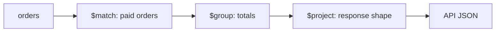

# Lesson 76 — Aggregation-based Dashboard Endpoints

[← Section 8](./README.md) · [Full curriculum](../README.md)

## 1. Why dashboards need aggregation

An admin dashboard asks: How many orders were paid this month? What is total revenue? Which products sell most? Loading thousands of orders into Node.js and looping through them wastes memory and network bandwidth. **MongoDB aggregation pipelines** perform filtering, grouping, summing and reshaping close to the data.

A pipeline is a sequence of stages: each stage consumes documents and passes transformed results to the next.



## 2. Define what revenue means first

Not every order counts as revenue. PENDING, CANCELLED and failed payments should not be counted as completed sales. Decide whether PAID and FULFILLED count, whether refunds subtract revenue, and whether the dashboard uses UTC or a business timezone. **A mathematically correct aggregation can still be a wrong business metric.**

For this lesson, we define **gross captured order value** as the sum of `totalMinor` for orders in `PAID` or `FULFILLED`. This is not accounting net revenue and does not subtract refunds.

## 3. Total paid orders and captured value

```js
const [stats] = await Order.aggregate([
  { $match: { status: { $in: ["PAID", "FULFILLED"] } } },
  {
    $group: {
      _id: null,
      orderCount: { $sum: 1 },
      grossCapturedMinor: { $sum: "$totalMinor" },
      averageOrderMinor: { $avg: "$totalMinor" }
    }
  },
  {
    $project: {
      _id: 0,
      orderCount: 1,
      grossCapturedMinor: 1,
      averageOrderMinor: 1
    }
  }
]);

const dashboard = stats ?? {
  orderCount: 0, grossCapturedMinor: 0, averageOrderMinor: 0
};
```

`$match` reduces input; `$group` computes totals; `$project` shapes the output. If no documents match, the grouping pipeline may return an empty array, so the endpoint needs a fallback.

## 4. Daily order trend

```js
const start = new Date("2026-10-01T00:00:00Z");
const end = new Date("2026-11-01T00:00:00Z");

const daily = await Order.aggregate([
  {
    $match: {
      status: { $in: ["PAID", "FULFILLED"] },
      createdAt: { $gte: start, $lt: end }
    }
  },
  {
    $group: {
      _id: {
        $dateToString: {
          format: "%Y-%m-%d",
          date: "$createdAt",
          timezone: "UTC"
        }
      },
      orders: { $sum: 1 },
      grossCapturedMinor: { $sum: "$totalMinor" }
    }
  },
  { $sort: { _id: 1 } }
]);
```

**Important:** Grouping by `createdAt` measures orders *created* during the period that are *currently paid*, not payments captured during that period. If the business wants actual payment timing, store `paidAt` and group by that timestamp. For India-specific calendar days, use `timezone:"Asia/Kolkata"` and carefully define period boundaries.

## 5. Top-selling products with unwind

Order items are embedded arrays. `$unwind` converts each array item into its own pipeline row, allowing product-level grouping.

```js
const topProducts = await Order.aggregate([
  { $match: { status: { $in: ["PAID", "FULFILLED"] } } },
  { $unwind: "$items" },
  {
    $group: {
      _id: "$items.productId",
      unitsSold: { $sum: "$items.quantity" },
      grossCapturedMinor: { $sum: "$items.lineTotalMinor" },
      name: { $last: "$items.name" }
    }
  },
  { $sort: { unitsSold: -1, _id: 1 } },
  { $limit: 10 }
]);
```

The stored order item snapshot is useful here: it preserves the price and name at purchase time. `$last` here means the last document in the pipeline's processing order; without a deliberate sort, it is **not guaranteed to be the newest name**. Prefer an explicit display-name policy or join current product metadata when needed.

## 6. Multiple metrics with $facet

```js
const [result] = await Order.aggregate([
  { $match: { status: { $in: ["PAID", "FULFILLED"] } } },
  {
    $facet: {
      totals: [
        { $group: { _id: null, orders: { $sum: 1 }, amount: { $sum: "$totalMinor" } } }
      ],
      recent: [
        { $sort: { createdAt: -1, _id: -1 } },
        { $limit: 5 },
        { $project: { userId: 1, totalMinor: 1, createdAt: 1 } }
      ]
    }
  }
]);
```

`$facet` computes several result sets from the same input, but it is not automatically faster than separate indexed queries. It has memory/result-size limits and may require processing substantial input. Measure query plans and latency.

## 7. Express endpoint and authorization

```js
router.get(
  "/dashboard",
  requireAuth,
  requireRole("ADMIN"),
  getDashboardController
);
```

A dashboard can reveal sensitive business data. Protect it server-side, cap date ranges, validate timezone/date inputs, and avoid accepting arbitrary aggregation pipelines from clients. For tenant-aware SaaS, include the tenant filter in every metric.

## 8. Performance and indexing

Index fields used by early `$match` stages, such as status and date. For example, `{status:1,createdAt:-1}` may help relevant filters. An index cannot magically make every `$group` cheap. Avoid unbounded multi-year queries on every page load; consider caching, materialized summaries or scheduled rollups when necessary.

## 9. Accuracy caveats

- Refunds and partial refunds require explicit modeling.
- Multiple currencies must not be summed without conversion.
- Totals may need taxes, discounts, shipping and payment fees defined separately.
- `$sum` and `$avg` use numeric semantics; choose money representation carefully.
- Missing days may need zero-filling in the API or UI.
- A transaction or consistency policy may matter if several collections jointly define a metric.

## 10. Exercises and interview review

Build endpoints for total captured value, daily orders and top five products. Compare `createdAt` versus `paidAt` grouping. Add a tenant filter. Explain **$match vs $group**, **why $unwind is needed**, and **why a dashboard metric needs a business definition before a pipeline**.

**References:** [MongoDB aggregation](https://www.mongodb.com/docs/manual/aggregation/) · [Mongoose aggregate](https://mongoosejs.com/docs/api/aggregate.html)
