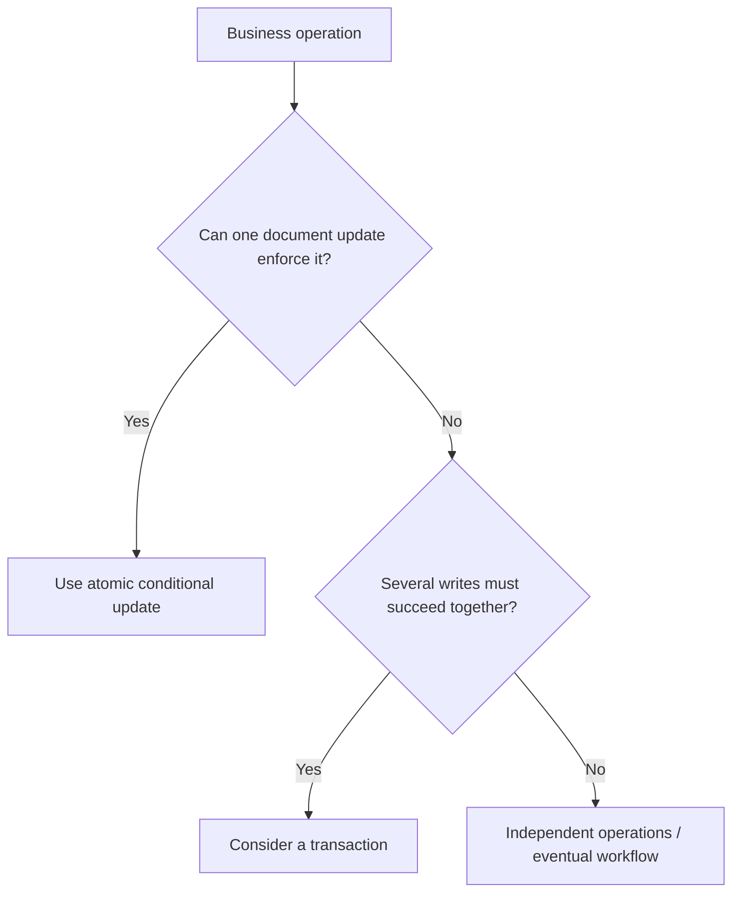

# Lesson 78 — MongoDB Atomicity and Isolation Basics

[← Section 9](./README.md) · [Full curriculum](../README.md)

# 1. The problem: a database operation can be interrupted

Imagine a product has **stock = 5**. A customer purchases two units. We need stock to become 3, not 4 or -1. Meanwhile another customer might be purchasing the same product.

Before learning transactions, understand the smallest consistency guarantee MongoDB already provides: **a write operation on a single document is atomic**. This means other operations do not observe a *partially applied* update to that document. It does **not** mean every sequence of reads and writes in your application becomes atomic.

This lesson separates three often-confused concepts:

- **Atomicity:** Does a change happen as one indivisible unit?
- **Isolation:** How do concurrent operations interact and what can they observe?
- **Durability:** Once acknowledged, how well does the write survive failures?

A transaction adds a boundary around multiple operations, but you should not start with a transaction if one conditional atomic update solves the problem.

# 2. Atomic single-document writes

Suppose an inventory document is:

```json
{
  "_id": "product-1",
  "name": "Wireless Mouse",
  "stock": 5,
  "sold": 10
}
```

The following MongoDB update changes two fields in **one document**:

```js
await db.collection("products").updateOne(
  { _id: "product-1" },
  { $inc: { stock: -2, sold: 2 } }
);
```

The stock decrement and sold increment form one atomic document update. MongoDB does not expose a state where stock has changed but sold has not **within that same update**.

Compare with two separate writes:

```js
await db.collection("products").updateOne(
  { _id: "product-1" }, { $inc: { stock: -2 } }
);
// Process could fail here.
await db.collection("products").updateOne(
  { _id: "product-1" }, { $inc: { sold: 2 } }
);
```

Each statement is individually atomic, but **the pair is not atomic as a unit**. A failure between them leaves an inconsistent relationship. Whenever possible, combine related changes into one update.

# 3. The lost-update problem

Two requests both read stock 5, each plans to buy 2, and each writes stock 3:

```text
Request A reads 5     Request B reads 5
Request A computes 3  Request B computes 3
Request A writes 3    Request B writes 3
Final stock = 3       Expected stock = 1 after both sales
```

The problem is **read-modify-write** performed outside a protected operation. The fact that each `save()` is atomic does not prevent an older value from overwriting a newer one.

```js
// UNSAFE under concurrent requests without version checking
const product = await Product.findById(productId);
if (product.stock >= 2) {
  product.stock -= 2;
  await product.save();
}
```

A `save()` can participate in optimistic concurrency when the schema enables it, but that is a different strategy from a guarded atomic update.

# 4. The correct one-document inventory operation

```js
const updated = await Product.findOneAndUpdate(
  { _id: productId, active: true, stock: { $gte: quantity } },
  { $inc: { stock: -quantity, sold: quantity } },
  { new: true }
);

if (!updated) {
  throw new Error("Product missing, inactive, or insufficient stock");
}
```

**Why this works:** MongoDB evaluates the filter against the document when applying the write. The condition `stock >= quantity` and the decrement belong to the same atomic operation. Two customers cannot both successfully reserve the final single item.

A filter on stock is crucial: `$inc` alone can produce negative stock.

# 5. Atomicity is not the same as isolation

Atomicity tells us an update does not become visible halfway through. Isolation concerns **what concurrent reads and writes can observe**.

Example: transferring ₹500 from wallet A to wallet B requires two documents:

```text
A: ₹1000       B: ₹200
A -= ₹500      B += ₹500
A: ₹500        B: ₹700
```

If the first update succeeds and the process fails before the second, money disappears from the combined balances. Single-document atomicity cannot guarantee **multi-document** consistency. This is where a transaction may be appropriate.



# 6. What isolation does not promise by default

A series of ordinary queries outside a transaction is **not** automatically a consistent snapshot:

```js
const totalUsers = await User.countDocuments();
const latestUsers = await User.find().sort({ createdAt: -1 }).limit(10);
```

A new user might be inserted between these two queries. The count and list can describe different moments in time.

Likewise, a normal read followed by a write does not lock the document for your JavaScript code. Other requests can modify it before your write executes.

For a coordinated snapshot across multiple operations, learn about transaction read concern in Lesson 083. Even transactions require correct filters and business rules; they are not a substitute for modeling invariants.

# 7. MongoDB vs Mongoose: who provides the guarantee?

MongoDB's storage engine implements atomic updates. Mongoose builds queries and sends operations through the MongoDB driver.

```js
// Native driver
await db.collection("products").updateOne(
  { _id: productId, stock: { $gte: 1 } },
  { $inc: { stock: -1 } }
);

// Mongoose
await Product.updateOne(
  { _id: productId, stock: { $gte: 1 } },
  { $inc: { stock: -1 } }
);
```

Both rely on MongoDB's underlying single-document atomicity. Mongoose validation and middleware do **not** create additional database-level atomicity.

**Important:** Query updates do not execute `save` middleware, and update validators are not a replacement for an atomic stock predicate.

# 8. Practical runnable experiment

Use a test database and a Product model with `stock`:

```js
import mongoose from "mongoose";
await mongoose.connect(process.env.MONGODB_URI);

const productSchema = new mongoose.Schema({
  name: String,
  stock: { type: Number, required: true, min: 0 }
});
const Product = mongoose.model("AtomicityDemoProduct", productSchema);

const product = await Product.create({ name: "Last keyboard", stock: 1 });

const buy = () => Product.findOneAndUpdate(
  { _id: product._id, stock: { $gte: 1 } },
  { $inc: { stock: -1 } },
  { new: true }
);

const results = await Promise.all([buy(), buy()]);
console.log(results.map(Boolean)); // Exactly one true, one false
console.log((await Product.findById(product._id)).stock); // 0

await Product.deleteOne({ _id: product._id });
await mongoose.disconnect();
```

The result order can vary because concurrency scheduling varies, but only **one** request can reserve the final item.

# 9. Important limitations

1. **Atomic does not mean durable across every failure.** Durability depends on write concern, replication and failure circumstances.
2. **Atomic does not mean globally isolated across several documents.** A two-document transfer requires a stronger design.
3. **Validation does not replace predicates.** Schema `min:0` is not a concurrency guarantee for arbitrary `$inc` updates.
4. **Reading first does not reserve anything.** Use a conditional write when the invariant can be checked atomically.
5. **A transaction is not always the best answer.** One-document operations are generally simpler and cheaper.

# 10. Exercises

- Create a product with stock 2; run five concurrent guarded purchases and confirm exactly two succeed.
- Update `stock` and `sold` in one operation, then deliberately split them into two operations and explain the failure window.
- Design a comment-like counter: when is `$inc` sufficient, and when would a transaction be needed?
- Explain why `findById() → modify → save()` may lose updates.

# 11. Interview review

**Q: Are MongoDB writes atomic?** Writes are atomic at the single-document level, including changes to multiple fields in that document.

**Q: Does that make multi-document checkout atomic?** No.

**Q: How can you stop stock becoming negative under concurrent orders?** Include `stock:{$gte:quantity}` in the update filter and decrement in the same operation.

**Official references:** [Atomicity and transactions](https://www.mongodb.com/docs/manual/core/write-operations-atomicity/) · [Mongoose findOneAndUpdate](https://mongoosejs.com/docs/tutorials/findoneandupdate.html)
