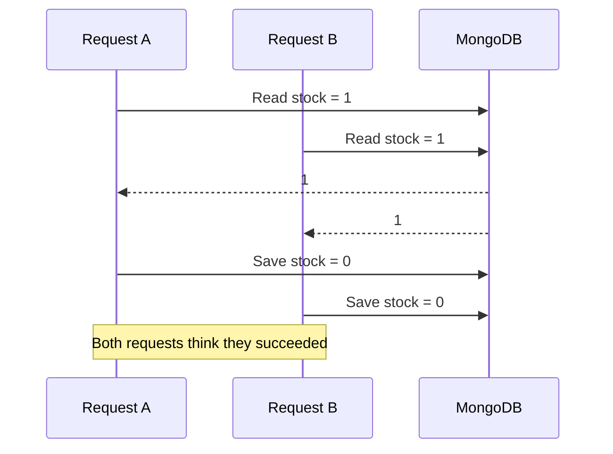

# Lesson 79 — Race Conditions and Conditional Updates

[← Section 9](./README.md) · [Full curriculum](../README.md)

# 1. Why concurrency is hard in Node.js

Node.js executes JavaScript on an event loop, but your API can still have **concurrent requests**. When request A awaits a database read, request B may proceed. Multiple application instances also run independently. Therefore, "Node.js is single-threaded" is **not** protection against database races.

A **race condition** occurs when correctness depends on the relative timing of operations.

We will explore three examples: inventory reservation, coupon redemption and job application state transitions.

# 2. Visualize a race condition



Two sales were accepted although only one unit existed. The final stock value may look valid, which makes this bug particularly dangerous.

# 3. Solution pattern: compare and update in one operation

```js
async function reserveStock(productId, quantity) {
  if (!Number.isSafeInteger(quantity) || quantity <= 0) {
    throw new Error("Quantity must be a positive integer");
  }

  const result = await Product.updateOne(
    { _id: productId, active: true, stock: { $gte: quantity } },
    { $inc: { stock: -quantity } }
  );

  if (result.matchedCount === 0) {
    return { reserved: false };
  }
  return { reserved: true };
}
```

The filter is the **precondition**; the update is the **state change**. MongoDB applies them atomically for one document. This is sometimes called a **compare-and-swap-like** operation.

The result does not distinguish missing product, inactive product and insufficient stock. An API can return a safe generic message or do a separate diagnostic read if appropriate; the diagnostic read must not be treated as the basis of the reservation.

# 4. Why $inc is safer than setting a computed value

```js
// Dangerous without a version guard
const product = await Product.findById(id);
await Product.updateOne({ _id: id }, { $set: { stock: product.stock - 1 } });
```

The computed value can be stale.

```js
// Atomic arithmetic on the server
await Product.updateOne(
  { _id: id, stock: { $gte: 1 } },
  { $inc: { stock: -1 } }
);
```

MongoDB performs arithmetic against the document's value at update time. Use `$inc` for counters, but still include the relevant business predicate when bounds matter.

# 5. State transitions: job application example

An application can move from `APPLIED` to `INTERVIEW`, but perhaps not from `REJECTED` back to `INTERVIEW` without a special workflow.

```js
async function scheduleInterview(applicationId, recruiterId) {
  const updated = await Application.findOneAndUpdate(
    {
      _id: applicationId,
      recruiterId,
      status: "APPLIED"
    },
    {
      $set: {
        status: "INTERVIEW",
        interviewScheduledAt: new Date()
      }
    },
    { new: true, runValidators: true }
  );

  if (!updated) {
    throw new Error("Application missing or no longer eligible");
  }
  return updated;
}
```

This simultaneously checks **ownership/authorization** and the **expected current status**. If another recruiter has already rejected the application, the filter no longer matches.

# 6. Coupon redemption: atomic limit enforcement

Suppose a coupon can be redeemed at most 100 times:

```js
const coupon = await Coupon.findOneAndUpdate(
  {
    code: "WELCOME",
    active: true,
    usedCount: { $lt: 100 }
  },
  { $inc: { usedCount: 1 } },
  { new: true }
);
if (!coupon) throw new Error("Coupon exhausted or unavailable");
```

This protects the **global counter** in one document. It does **not** guarantee each user redeems only once. That requires an additional uniqueness rule, such as a unique index on `{couponId,userId}` in a redemption collection, and often a transaction to keep the counter and redemption record consistent.

# 7. Optimistic concurrency with __v

When users edit a whole document, they may need to detect stale edits rather than atomically increment one field.

```js
const schema = new mongoose.Schema(
  { title: String, description: String },
  { optimisticConcurrency: true }
);
const Document = mongoose.model("ConcurrencyDocument", schema);

const doc = await Document.create({ title: "Draft" });
const a = await Document.findById(doc._id);
const b = await Document.findById(doc._id);

a.title = "Updated by A";
await a.save();

b.title = "Updated by B";
try {
  await b.save();
} catch (error) {
  console.log(error.name); // VersionError
}
```

With `optimisticConcurrency:true`, Mongoose document `save()` uses the version key to detect a conflicting save. **Do not assume** that `updateOne()` or `findOneAndUpdate()` automatically performs the same version check.

# 8. Explicit version-guarded query update

```js
const expectedVersion = 3;
const result = await Document.updateOne(
  { _id: documentId, __v: expectedVersion },
  {
    $set: { title: "Reviewed" },
    $inc: { __v: 1 }
  },
  { runValidators: true }
);
if (result.matchedCount === 0) {
  throw new Error("Not found or stale version");
}
```

This only works reliably if **all relevant writers** participate in the same version policy. A raw update that changes the document without incrementing `__v` can bypass this protection.

# 9. Distinguish four concurrency tools

| Tool | Best for | Important limitation |
| --- | --- | --- |
| `$inc` + condition | Stock, counters, capacity | One document only |
| Expected status in filter | Workflow state transitions | Does not coordinate separate documents |
| Optimistic concurrency | Detect stale document edits | Requires consistent writer behavior |
| Transaction | Coordinated multi-document changes | Retries and side-effect discipline required |

Don't use a transaction automatically for a single guarded stock decrement. Don't use an in-memory JavaScript lock to coordinate stock across multiple Node.js processes.

# 10. HTTP conflict handling

A failed precondition may mean a **409 Conflict**, for example “This application was already updated.” An insufficient-stock response can be 409 or a domain-specific error under your API contract. If using HTTP conditional headers such as `If-Match`, a failed precondition is commonly **412 Precondition Failed**.

Avoid blindly retrying a user's stale edit: the second writer may have made a legitimate change.

# 11. Stress test concurrency

```js
const product = await Product.create({
  name: "Limited Edition", stock: 3, active: true
});
const attempts = await Promise.all(
  Array.from({ length: 20 }, () => reserveStock(product._id, 1))
);
const successes = attempts.filter(x => x.reserved).length;
console.log({ successes }); // 3
console.log((await Product.findById(product._id)).stock); // 0
```

Use an isolated test database and clean up test data. A concurrency test should assert invariants rather than exact completion order.

# 12. Practice and interview preparation

Implement a booking system where each slot has capacity 5; use a guarded `$inc` to reserve places. Then add a unique `{slotId,userId}` reservation constraint and explain why the second requirement crosses document boundaries.

**Interview questions:** Why can races occur in single-threaded Node.js? Why is `$inc` safer than read-modify-set? How do you enforce valid state transitions? When do you prefer optimistic concurrency over a transaction?

**Official references:** [MongoDB atomicity](https://www.mongodb.com/docs/manual/core/write-operations-atomicity/) · [Mongoose optimistic concurrency](https://mongoosejs.com/docs/guide.html#optimisticConcurrency)
