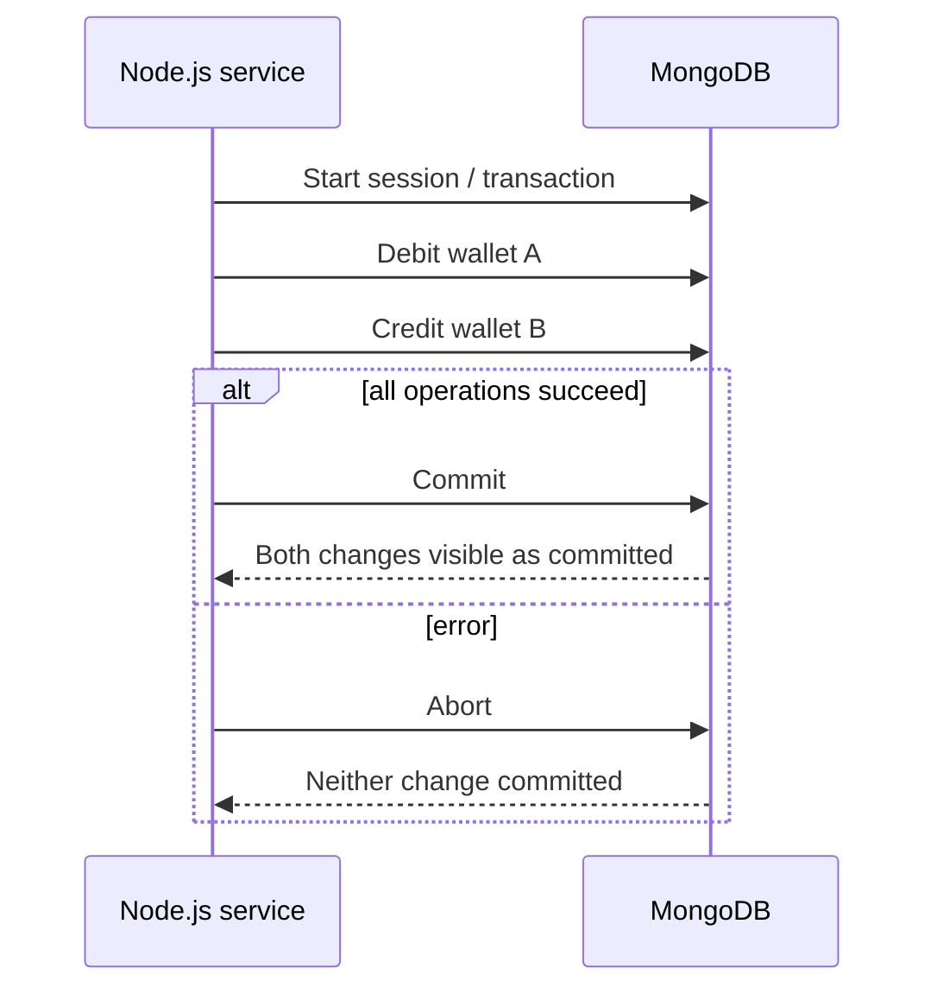

# Lesson 80 — Transactions with Mongoose Sessions

[← Section 9](./README.md) · [Full curriculum](../README.md)

# 1. The problem: one business operation, multiple documents

A wallet transfer must subtract money from one wallet **and** add it to another. If only the subtraction succeeds, the system loses money. Each document update is atomic individually, but the business operation needs **all-or-nothing** behavior across documents.

A MongoDB **transaction** groups multiple database operations into one commit/abort boundary. A **session** carries the transaction context so MongoDB knows which operations belong together.



# 2. Requirements before running examples

Multi-document transactions require MongoDB deployed as a **replica set or sharded cluster**, not a standalone mongod. Atlas clusters normally provide a supported topology. For local practice, run a single-node replica set or a replica-set-capable test environment.

```bash
npm install mongoose dotenv
```

```js
import "dotenv/config";
import mongoose from "mongoose";
await mongoose.connect(process.env.MONGODB_URI);
```

# 3. Model wallets and transfers

```js
const { Schema } = mongoose;

const walletSchema = new Schema({
  ownerId: { type: Schema.Types.ObjectId, required: true, unique: true },
  balanceMinor: { type: Number, required: true, min: 0 }
}, { timestamps: true });

const transferSchema = new Schema({
  fromWalletId: { type: Schema.Types.ObjectId, required: true },
  toWalletId: { type: Schema.Types.ObjectId, required: true },
  amountMinor: { type: Number, required: true, min: 1 },
  status: { type: String, enum: ["COMPLETED"], required: true }
}, { timestamps: true });

const Wallet = mongoose.model("TransactionDemoWallet", walletSchema);
const Transfer = mongoose.model("TransactionDemoTransfer", transferSchema);
```

Use integer minor units for money. A real financial ledger needs additional controls: idempotency, auditability, reconciliation, authorization, and a careful numeric representation.

# 4. The wrong implementation

```js
await Wallet.updateOne(
  { _id: fromWalletId },
  { $inc: { balanceMinor: -amountMinor } }
);

// Process crashes or next operation fails.
await Wallet.updateOne(
  { _id: toWalletId },
  { $inc: { balanceMinor: amountMinor } }
);
```

This has two independent commits. A crash between them can leave the system inconsistent. The first update also lacks a balance precondition, so it may create a negative balance.

# 5. A correct transactional transfer example

```js
async function transferFunds(fromWalletId, toWalletId, amountMinor) {
  if (!Number.isSafeInteger(amountMinor) || amountMinor <= 0) {
    throw new Error("Invalid amount");
  }
  if (String(fromWalletId) === String(toWalletId)) {
    throw new Error("Cannot transfer to same wallet");
  }

  return mongoose.connection.transaction(async (session) => {
    const debit = await Wallet.updateOne(
      {
        _id: fromWalletId,
        balanceMinor: { $gte: amountMinor }
      },
      { $inc: { balanceMinor: -amountMinor } },
      { session }
    );
    if (debit.matchedCount !== 1) {
      throw new Error("Sender missing or insufficient balance");
    }

    const credit = await Wallet.updateOne(
      { _id: toWalletId },
      { $inc: { balanceMinor: amountMinor } },
      { session }
    );
    if (credit.matchedCount !== 1) {
      throw new Error("Recipient wallet not found");
    }

    const [transfer] = await Transfer.create(
      [{
        fromWalletId,
        toWalletId,
        amountMinor,
        status: "COMPLETED"
      }],
      { session }
    );

    return transfer;
  });
}
```

**Walkthrough:**

1. Validate input *before* starting a transaction.
2. Start a transaction with `mongoose.connection.transaction()`.
3. Debit only if the sender has sufficient funds.
4. Credit the recipient inside **the same session**.
5. Insert a transfer record inside the session.
6. If the callback completes successfully, the helper commits.
7. If it throws, the helper aborts and propagates the error.

**Critical:** Every operation that must be atomic must use the **same session**. Accidentally omitting `{session}` from one query can write outside the transaction.

# 6. What does a session actually do?

A session is not a JavaScript lock. It identifies a logical sequence of operations and carries transaction state. MongoDB coordinates the transaction on the server. Two concurrent transactions may conflict when modifying the same data; MongoDB can abort one with a transient error.

```js
// Lower-level alternative:
const session = await mongoose.startSession();
try {
  await session.withTransaction(async () => {
    await Wallet.updateOne(
      { _id: fromWalletId },
      { $inc: { balanceMinor: -100 } },
      { session }
    );
    // Other session-bound operations...
  });
} finally {
  await session.endSession();
}
```

The higher-level `connection.transaction()` integrates with Mongoose document change tracking, making it a convenient default for Mongoose applications. Do not mix independent sessions within one intended atomic workflow.

# 7. Why not Promise.all inside a transaction?

```js
// Avoid:
await mongoose.connection.transaction(async session => {
  await Promise.all([
    Wallet.updateOne(filterA, updateA, { session }),
    Wallet.updateOne(filterB, updateB, { session })
  ]);
});
```

Mongoose documents that parallel operations inside a transaction are **unsupported/undefined behavior**. Execute session operations sequentially. Keep transactions short to reduce conflicts and resource pressure.

# 8. What happens if the callback fails?

```js
try {
  await mongoose.connection.transaction(async session => {
    await Wallet.updateOne(
      { _id: fromId, balanceMinor: { $gte: 100 } },
      { $inc: { balanceMinor: -100 } },
      { session }
    );
    throw new Error("Simulated failure");
  });
} catch (error) {
  console.log(error.message); // Simulated failure
}
```

The transaction is aborted; session-bound writes do not commit. This is why you should **throw** when a required operation fails. Catching and swallowing an error *inside* the transaction callback can cause the helper to treat the callback as successful and commit unintended partial business work.

# 9. Transactions are not external-world transactions

```js
await mongoose.connection.transaction(async session => {
  await Order.create([{ /* ... */ }], { session });
  await paymentGateway.chargeCard(); // DANGEROUS design
});
```

If MongoDB retries the transaction callback, the external charge might happen twice. If the charge succeeds and the DB transaction aborts, money may move without a committed order.

**Better architecture:** Commit database state and a durable outbox record together, then process the external effect separately with idempotency and reconciliation. Lesson 081 explains retries; Lesson 082 explains idempotency.

# 10. Isolation and transaction limitations

Transactions provide an atomic commit boundary, but do not automatically solve every business race. Use guarded predicates such as `balanceMinor:{$gte:amount}`, unique constraints, and appropriate read/write concerns. Transactional reads can use snapshot semantics under appropriate settings; read concern, write concern and read preference are explored in Lesson 083.

Transactions have runtime and resource limits. Long-running transactions increase contention and can be aborted. Keep network calls and user interaction **outside** the callback.

# 11. Hands-on rollback test

1. Create two wallets: A = 1000, B = 200 (minor units).
2. Transfer 300. Verify A = 700, B = 500, and a transfer record exists.
3. Attempt transfer 900 from A. Expect an error; balances remain unchanged.
4. Attempt a transfer to a missing wallet. Verify the earlier debit is rolled back.
5. Deliberately remove `{session}` from one write in a disposable test environment. Explain the inconsistency risk.

# 12. Interview questions

**What is a session?** Context associating operations with a transaction.

**Does a transaction replace atomic conditions?** No; business invariants still need to be enforced.

**Can a transaction roll back a payment gateway call?** No.

**Why avoid long transactions?** More contention, conflicts, resource usage and abort risk.

**Official references:** [Mongoose transactions](https://mongoosejs.com/docs/transactions.html) · [MongoDB transactions](https://www.mongodb.com/docs/manual/core/transactions/)
