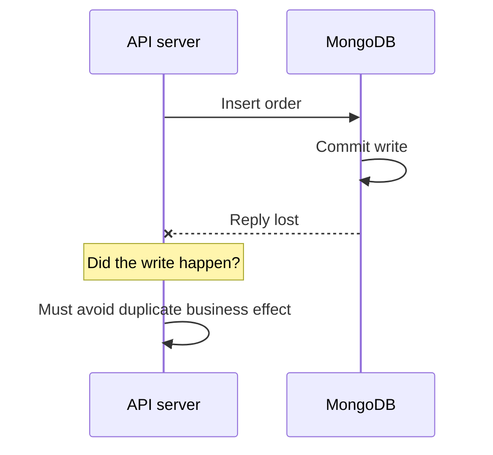

# Lesson 81 — Retryable Writes and Transaction Retries

[← Section 9](./README.md) · [Full curriculum](../README.md)

# 1. The hidden problem: the network can fail after success

Suppose an API sends “create order” to MongoDB. MongoDB commits the write, but the network drops before the client receives the response. From the application's perspective, the outcome may be **unknown**.

If the app blindly repeats the entire business request, it may create a second order. This is why we must distinguish **retrying a database operation**, **retrying a transaction**, and **retrying a business command**.



# 2. Three kinds of retry

| Mechanism | What is retried? | Who handles it? |
| --- | --- | --- |
| Retryable write | Eligible individual write operation | MongoDB driver |
| Transaction retry | Transaction body after certain transient errors | Driver helper / application |
| Business request retry | HTTP request, checkout, payment, job | Application with idempotency |

These are **not interchangeable**. Driver retryable writes can reduce duplicate execution of eligible commands within the retry protocol, but they do not make arbitrary HTTP requests idempotent.

# 3. Retryable writes

MongoDB drivers support retryable writes for eligible operations when deployment and configuration requirements are met. Atlas connection strings commonly include `retryWrites=true`.

```js
await mongoose.connect(process.env.MONGODB_URI, {
  retryWrites: true,
  serverSelectionTimeoutMS: 5000
});
```

The driver uses session and transaction identifiers to help the server recognize a retry of an eligible write. Support depends on topology and operation type. Not every command is retryable; not every error should be retried.

**Example:** If a driver sends one eligible insert and loses the response, a supported retry can avoid applying the same write twice under the protocol. But if your Express controller receives a **second independent HTTP POST**, that is a new business operation unless you implement an idempotency policy.

# 4. Transaction errors: two important labels

MongoDB transaction failures may carry labels:

- **TransientTransactionError:** The transaction may be safely retried from the beginning under the documented retry policy.
- **UnknownTransactionCommitResult:** The client cannot determine whether commit succeeded; retrying the **commit decision** is different from replaying the whole business operation.

These labels are meaningful protocol signals, not ordinary strings to match in error messages.

```js
if (error.hasErrorLabel?.("TransientTransactionError")) {
  // Transaction retry policy may apply.
}
if (error.hasErrorLabel?.("UnknownTransactionCommitResult")) {
  // Commit outcome is uncertain; do not blindly recreate business work.
}
```

# 5. Prefer the supported transaction helper

```js
await mongoose.connection.transaction(async (session) => {
  const debit = await Wallet.updateOne(
    { _id: senderId, balanceMinor: { $gte: amountMinor } },
    { $inc: { balanceMinor: -amountMinor } },
    { session }
  );
  if (debit.matchedCount !== 1) throw new Error("Insufficient balance");

  await Wallet.updateOne(
    { _id: recipientId },
    { $inc: { balanceMinor: amountMinor } },
    { session }
  );
});
```

Mongoose's `connection.transaction()` uses the driver's transaction helper, which implements retry handling for certain labeled errors. **The callback may execute more than once.** Therefore, do not assume “I saw this function run once in development” means it is exactly-once execution.

# 6. Why external side effects are unsafe inside retry callbacks

```js
// WRONG: the callback may be re-executed
await mongoose.connection.transaction(async session => {
  await Order.create([{ /* ... */ }], { session });
  await sendEmail("Order placed");
  await chargeCreditCard();
});
```

A retry may send duplicate emails or charges, and a MongoDB rollback cannot reverse a payment provider's operation.

Instead, record a durable **outbox event** inside the transaction:

```js
await mongoose.connection.transaction(async session => {
  const [order] = await Order.create(
    [{ userId, status: "PENDING" }],
    { session }
  );

  await OutboxEvent.create([{
    type: "ORDER_CREATED",
    aggregateId: order._id,
    payload: { orderId: order._id.toString() },
    processedAt: null
  }], { session });
});
```

A separate worker sends the email/payment request and marks the event processed. Workers can also retry, so consumers need idempotency. This example omits the full schema and worker implementation; its purpose is to show the transaction boundary.

# 7. Exponential backoff and jitter

When the application must retry a transient operation, avoid hammering a failing service:

```js
import { setTimeout as delay } from "node:timers/promises";

async function retryTransient(operation, { attempts = 4 } = {}) {
  for (let attempt = 0; attempt < attempts; attempt++) {
    try {
      return await operation();
    } catch (error) {
      const transient = error.hasErrorLabel?.("TransientTransactionError");
      if (!transient || attempt === attempts - 1) throw error;
      const base = Math.min(100 * 2 ** attempt, 1500);
      await delay(Math.floor(Math.random() * base));
    }
  }
}
```

**Important:** This is an educational retry wrapper for a **deliberately safe, replayable operation**, not something to wrap blindly around `connection.transaction()` (which already has retry behavior). Do not retry validation errors, insufficient balance, authorization failures, duplicate business requests, or arbitrary non-idempotent external calls. Bound attempts and time.

# 8. The ambiguous commit trap

Suppose commit succeeds but the reply is lost. A new transaction that creates another order is **not** the same as retrying the original commit. The system may already have completed the operation.

An application-level idempotency key allows the server to recognize a repeat of the same logical request. Lesson 082 will implement a unique key and replay-safe response strategy.

# 9. Exactly once vs effectively once

Distributed systems often provide **at-least-once delivery** of messages and retries. “Exactly once” business behavior usually requires **deduplication, unique constraints, idempotent state transitions and reconciliation**, not a single magical flag.

Example: a webhook may arrive twice. Store a unique provider event ID and only apply the corresponding business transition once. A unique index is a critical guard, but its coordination with other writes may require a transaction.

# 10. Failure matrix

| Failure | What to do |
| --- | --- |
| Invalid product ID | Return 400, no retry |
| Insufficient stock | Return conflict, no retry |
| Transient transaction error | Use supported bounded retry policy |
| Unknown commit result | Resolve commit outcome; avoid replaying whole business request |
| Duplicate key for same idempotency key | Read existing operation and compare request |
| Payment gateway timeout | Query provider status / reuse provider idempotency key |

# 11. Exercises

- Explain what happens when MongoDB commits but the API response is lost.
- Demonstrate why a transaction callback must not send an email.
- Build an outbox event with a unique event ID.
- Simulate a duplicated webhook and prevent double-processing.
- Explain the difference between retrying an eligible database write and retrying an HTTP checkout.

# 12. Interview review

**Q: What are retryable writes?** Driver-supported retries for eligible individual database writes under protocol constraints.

**Q: Can transaction callbacks run more than once?** Yes, under supported retry behavior.

**Q: What does UnknownTransactionCommitResult mean?** The client is uncertain about the commit outcome.

**Q: Do retryable writes make checkout idempotent?** No. You need application-level deduplication.

**Official references:** [MongoDB retryable writes](https://www.mongodb.com/docs/manual/core/retryable-writes/) · [MongoDB transaction retry](https://www.mongodb.com/docs/manual/core/transactions/#transactions-and-retryable-writes) · [Mongoose transactions](https://mongoosejs.com/docs/transactions.html)
