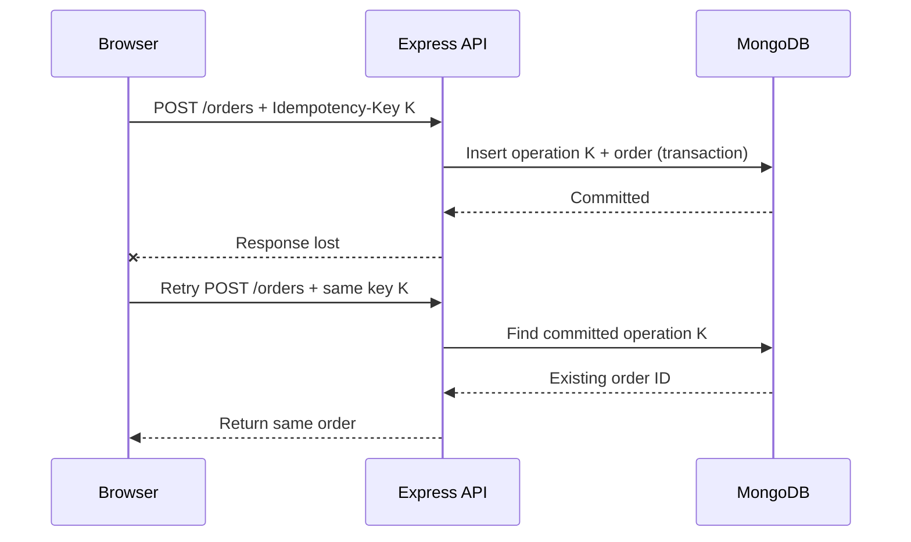

# Lesson 82 — Idempotency Keys and Unique Constraints

[← Section 9](./README.md) · [Full curriculum](../README.md)

## 1. The real problem: a successful request can look like a failure

Imagine a customer presses **Place Order**. Your Express server creates the order in MongoDB, but the network connection drops before the HTTP response reaches the browser. The customer sees a timeout and presses the button again.

Without protection, the backend might create **two orders**, reserve stock twice, and perhaps charge the customer twice. The first operation succeeded; only the *response* failed. This is not a rare edge case: mobile networks, reverse proxies, load balancers, retrying clients, and worker queues all produce duplicate delivery.

The important question is not “Did the API receive this HTTP request before?” It is **“Is this request another attempt at the same logical business operation?”**

### Idempotency in plain English

An operation is **idempotent** when repeating it has the same intended effect as doing it once. Setting `status = "CANCELLED"` can be idempotent; incrementing `stockSold` is not automatically idempotent.

```text
POST /orders   request A   → order #101 created → response lost
POST /orders   request A   → same order #101 returned (not #102)
```

We want **effectively-once business behavior**, even though requests may be delivered more than once. This is an application-level guarantee; retryable MongoDB writes alone do not provide it.

## 2. Understand the three different protections

| Protection | What it guarantees | What it does not guarantee |
| --- | --- | --- |
| Idempotency key | Repeated attempts with the same key can reuse one logical result | Does not itself prevent concurrent inserts |
| Unique index | MongoDB prevents two committed documents with the same indexed key | Does not know whether two different keys represent the same purchase |
| Transaction | Several MongoDB writes commit or abort together | Does not undo external payment calls |

For a robust checkout, these techniques often work **together**.



## 3. Who creates the key and how long should it live?

The **client creates a new key for each new logical action** and reuses it for retries of that action. In a browser:

```js
const idempotencyKey = crypto.randomUUID();

await fetch("/api/orders", {
  method: "POST",
  credentials: "include",
  headers: {
    "Content-Type": "application/json",
    "Idempotency-Key": idempotencyKey
  },
  body: JSON.stringify({ cartId })
});
```

If the request times out, retry using **the same key**, not a fresh UUID. Generate a fresh key only when the user deliberately starts a new checkout. The client should preserve the key across the retry lifecycle; if a page reload can interrupt checkout, persist the pending operation safely.

Keys should be hard to guess and sufficiently unique. **Scope them to the authenticated user or tenant**, so one user's key cannot reveal another user's result. Establish a documented retention period; deleting old records means very late retries may no longer be deduplicated.

## 4. Define a database-enforced uniqueness boundary

```js
// src/models/idempotency-record.model.js
import mongoose from "mongoose";
const { Schema } = mongoose;

const idempotencySchema = new Schema({
  userId: { type: Schema.Types.ObjectId, required: true, ref: "User" },
  key: { type: String, required: true },
  requestHash: { type: String, required: true },
  orderId: { type: Schema.Types.ObjectId, ref: "Order", required: true },
  createdAt: { type: Date, default: Date.now }
});

idempotencySchema.index({ userId: 1, key: 1 }, { unique: true });

export const IdempotencyRecord = mongoose.model(
  "IdempotencyRecord", idempotencySchema
);
```

**Why a compound unique index?** Two different users can both use key `abc` without colliding. For one user, only one committed record may use that key.

A `unique` index is enforced by **MongoDB**, not Mongoose validation. Ensure indexes have actually been created before relying on them; production deployments commonly manage indexes explicitly. A duplicate attempt produces MongoDB error code **11000**.

## 5. Why compare request payloads?

A buggy or malicious client might reuse the same key with a different cart:

```text
Key K + cart A → order #101
Key K + cart B → must NOT silently return order #101
```

Store a fingerprint of the meaningful, **canonicalized** request, not raw JSON string order. For example, normalize the cart ID and selected shipping option, then hash those fields.

```js
import { createHash } from "node:crypto";

function fingerprint({ cartId, shippingOption }) {
  const canonical = JSON.stringify({
    cartId: String(cartId),
    shippingOption: String(shippingOption)
  });
  return createHash("sha256").update(canonical).digest("hex");
}
```

This example works because the object keys are constructed in a fixed order. For complex nested payloads, use a well-defined canonical serialization scheme. Do not include secrets in logs or error messages. A hash is useful for comparing request intent, not for authorizing a user.

## 6. Transactional checkout: simplified implementation

We need to create **one order** and its **idempotency record** in the same transaction. This example assumes a trusted service has already validated the cart and calculated a safe `totalMinor`. It demonstrates deduplication; it is **not** a full inventory/payment workflow.

```js
import mongoose from "mongoose";
import { Order } from "../models/order.model.js";
import { IdempotencyRecord } from "../models/idempotency-record.model.js";

export async function createOrderOnce({ userId, key, cartId, shippingOption }) {
  if (typeof key !== "string" || !/^[a-zA-Z0-9-]{16,128}$/.test(key)) {
    throw new Error("Invalid idempotency key");
  }

  const requestHash = fingerprint({ cartId, shippingOption });

  const existing = await IdempotencyRecord.findOne({ userId, key }).lean();
  if (existing) {
    if (existing.requestHash !== requestHash) {
      throw new Error("Idempotency key reused for different request");
    }
    return Order.findOne({ _id: existing.orderId, userId }).lean();
  }

  try {
    return await mongoose.connection.transaction(async (session) => {
      // Replace these sample fields with server-validated cart snapshots.
      const [order] = await Order.create([{
        userId,
        items: [{ /* validated snapshot fields go here */ }],
        totalMinor: 0,
        status: "PENDING"
      }], { session });

      await IdempotencyRecord.create([{
        userId, key, requestHash, orderId: order._id
      }], { session });

      return order;
    });
  } catch (error) {
    if (error?.code !== 11000) throw error;

    // A competing request may have committed the same key.
    const winner = await IdempotencyRecord.findOne({ userId, key }).lean();
    if (!winner) throw error;
    if (winner.requestHash !== requestHash) {
      throw new Error("Idempotency key reused for different request");
    }
    return Order.findOne({ _id: winner.orderId, userId }).lean();
  }
}
```

**Important implementation note:** The sample order payload is intentionally a placeholder. A real Order schema may reject the placeholder, and it must not be used as checkout code. Substitute the complete validated order snapshots and stock reservation operations from Lesson 074 **inside the same transaction**. In production, ensure transaction conflicts and concurrent in-progress attempts have a bounded retry/409 policy; a unique-key conflict does not guarantee the winner is already visible at the instant you re-read.

### Walkthrough

1. Validate the idempotency key and authenticated user.
2. Calculate a deterministic fingerprint for the logical operation.
3. If a committed record exists, verify the fingerprint and return its order.
4. Otherwise start a transaction and create the order.
5. Create the idempotency record in the **same session**.
6. MongoDB's unique index prevents two committed records for the same `(userId,key)`.
7. If a concurrent request loses the race, read the winner's committed result after appropriate conflict handling.
8. A later retry returns the existing order rather than repeating business effects.

The initial `findOne` is only a **fast path**. It is **not** the concurrency guarantee; the unique index and transaction provide that.

## 7. Why a simple check-then-insert is unsafe

```js
// WRONG
const existing = await IdempotencyRecord.findOne({ userId, key });
if (!existing) {
  await Order.create({ /* ... */ });
  await IdempotencyRecord.create({ userId, key });
}
```

Two requests can both observe “not found.” Worse, the order can be committed before the idempotency record insert fails. You end up with a duplicate order that has no deduplication record. A unique index without an atomic relationship to the business write is not enough.

## 8. What about payment gateways?

A MongoDB transaction **cannot roll back a card charge**. A safe payment flow generally needs a durable payment intent/state machine, a provider-side idempotency key, verified webhooks, and reconciliation.

```text
1. Commit order + payment intent (database transaction)
2. Worker requests payment using stable provider idempotency key
3. Provider may reply late or send duplicate webhooks
4. Webhook handler verifies authenticity and event identity
5. Conditional state transition records payment exactly once
6. Reconciliation resolves uncertain outcomes
```

Never charge a card inside a transaction callback that might be retried. Deduplicate provider webhook event IDs with a unique index, and coordinate event processing with state changes in a transaction where needed.

## 9. HTTP response policy

A practical contract might return **201 Created** for the first completed request and **200 OK** with the same order for an identical replay. Some APIs replay the original status and response body instead. For the same key with a different request, use **409 Conflict**. For a still-running identical request, return a documented in-progress response or wait for its outcome.

Do not expose an existing order just because a caller knows its key: always scope by authenticated identity.

## 10. Tests you must write

- Same user + same key + same payload twice → exactly one order.
- Same user + same key + different payload → 409; no second order.
- Different users + same key → independent operations.
- Twenty concurrent attempts with the same key → at most one committed order.
- Simulated crash before transaction commit → no partial order/idempotency record.
- Response lost after commit → retry returns original order.
- Duplicate webhook → no duplicate payment state transition.
- Key expired → behavior follows a documented retention policy.

## 11. Interview questions

**Q: Are POST requests automatically idempotent?** No. They can be designed to be idempotent using a stable logical operation key.

**Q: Why is a unique index needed?** Application check-then-insert has a race; the database must enforce uniqueness.

**Q: Why is a transaction needed with the key?** So the business record and deduplication record commit or abort together.

**Q: Does this guarantee a payment provider is charged exactly once?** No; provider idempotency and reconciliation are separate.

**Official references:** [MongoDB unique indexes](https://www.mongodb.com/docs/manual/core/index-unique/) · [MongoDB transactions](https://www.mongodb.com/docs/manual/core/transactions/) · [Stripe idempotent requests](https://docs.stripe.com/api/idempotent_requests)
