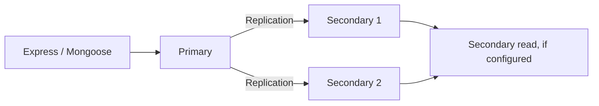

# Lesson 83 — Consistency and Read/Write Concerns

[← Section 9](./README.md) · [Full curriculum](../README.md)

## 1. Why a successful write can still surprise you

A customer updates their profile, receives “Saved,” and immediately reads from another server. Could the read return old data? What if the MongoDB primary crashes immediately after acknowledging the write? Can another node read the update before it is replicated?

These questions are about **consistency, replication and durability**. MongoDB offers configurable read and write concerns because applications have different needs: a social-media view counter and a financial ledger should not necessarily make the same trade-offs.

Do not confuse three settings:

- **Write concern:** How much acknowledgment is required for a write?
- **Read concern:** What consistency/visibility guarantee applies to a read?
- **Read preference:** Which replica-set member is eligible to serve the read?

They solve different problems. Read preference alone does not guarantee freshness, and write concern alone does not create an atomic multi-document workflow.

## 2. Replica-set mental model



In a typical replica set, the **primary** accepts writes and replicates operations to secondaries. Replication is asynchronous. A secondary may temporarily lag behind, so a secondary read can observe older data.

MongoDB can elect a new primary if the current primary becomes unavailable. The application's guarantees depend on read concern, write concern, sessions, failover and topology.

## 3. Write concern: what does “acknowledged” mean?

Write concern describes the acknowledgment requested from MongoDB.

```js
await Product.updateOne(
  { _id: productId },
  { $set: { name: "New Name" } },
  { writeConcern: { w: "majority" } }
);
```

**`w:1`** requests acknowledgment from the primary. It can be faster but a write that has not reached a majority can be rolled back during failover.

**`w:"majority"`** requests acknowledgment after the write has been acknowledged by a majority of voting data-bearing members according to MongoDB's write-concern rules. This substantially strengthens durability against primary failover, but is not a guarantee against every possible disaster.

**`w:0`** means unacknowledged writes; avoid it for critical business data because the application cannot reliably know the outcome.

The **journal** setting `j` concerns on-disk journal acknowledgment. Its interaction with majority write concern depends on server configuration and version. Do not assume `w:1` is durable just because the driver returned success.

## 4. Read preference: where should reads go?

```js
const product = await Product.findById(productId)
  .read("primary")
  .lean();
```

Common choices:

| Preference | Meaning | Typical trade-off |
| --- | --- | --- |
| primary | Read from primary | Avoid secondary replication lag; primary load |
| secondary | Read from secondary | Potentially stale reads; may fail if no secondary |
| primaryPreferred | Prefer primary, fallback as allowed | Behavior changes during failover |
| secondaryPreferred | Prefer secondary, fallback as allowed | Potentially stale reads |
| nearest | Choose eligible low-latency member | May return stale data |

For user-visible data that must reflect recent writes, primary reads are a sensible starting point. But **primary preference by itself does not replace the stronger guarantees of appropriate read/write concerns and sessions**.

## 5. Read concern: what visibility is guaranteed?

Read concern controls the isolation and consistency properties of returned data.

- **local:** Returns data from the node's current view; that data may not be majority committed.
- **majority:** Returns data acknowledged by a majority, subject to MongoDB's documented semantics and deployment support.
- **snapshot:** Provides a point-in-time view in supported contexts, notably transactions and certain snapshot reads.
- **linearizable:** Stronger real-time read semantics for eligible single-document reads from the primary, with important restrictions and latency costs.
- **available:** Specialized option with weaker consistency properties in certain sharded scenarios.

The words “majority” and “linearizable” do **not** mean the same thing. A majority read can still be older than a write that happened later. Linearizable reads have stricter applicability and should not be enabled blindly across an API.

## 6. Read-your-writes with causally consistent sessions

Suppose a user updates their profile and immediately fetches it. **Causal consistency** can help ensure later reads in the same session observe causally earlier writes when its required read/write concerns are used.

```js
const session = await mongoose.startSession({
  causalConsistency: true
});

try {
  await User.updateOne(
    { _id: userId },
    { $set: { displayName: "Asha" } },
    { session, writeConcern: { w: "majority" } }
  );

  const user = await User.findById(userId)
    .session(session)
    .readConcern("majority")
    .lean();

  console.log(user.displayName); // Asha, subject to successful operations and session guarantees
} finally {
  await session.endSession();
}
```

The guarantee depends on **using the same causally consistent session**, majority read concern, majority write concern, and supported deployment semantics. Two independent requests without shared causal context do not automatically inherit the guarantee.

Do not share one session concurrently across unrelated requests. For many APIs, reading from the primary after a successful write is adequate; use causal sessions when the requirement actually calls for them.

## 7. Transactions: read concern and write concern together

A multi-document transaction can use transaction-level options:

```js
await mongoose.connection.transaction(async session => {
  const from = await Wallet.findById(fromWalletId).session(session);
  if (!from) throw new Error("Missing wallet");

  await Wallet.updateOne(
    { _id: fromWalletId, balanceMinor: { $gte: 100 } },
    { $inc: { balanceMinor: -100 } },
    { session }
  );
}, {
  readConcern: { level: "snapshot" },
  writeConcern: { w: "majority" },
  readPreference: "primary"
});
```

**Important:** The example only illustrates options; it is not a complete transfer (Lesson 080 contains that). Transaction-level snapshot semantics depend on a successful transaction commit with appropriate write concern. A snapshot is not an excuse to omit conditional updates, unique indexes, or authorization.

## 8. A practical failover story

Consider:

```text
T1: Primary accepts a write with w:1
T2: API receives success
T3: Primary fails before majority replication
T4: Another member becomes primary
T5: Uncommitted write may be rolled back
```

Now compare a majority-acknowledged write: it has been replicated to the required majority before success is reported, so it is protected against this ordinary failover rollback scenario under MongoDB's guarantees.

The trade-off is often additional latency. Critical orders and financial state commonly justify stronger acknowledgment; high-volume ephemeral counters may tolerate different settings.

## 9. Eventual consistency is not always a bug

Imagine a dashboard reading from a secondary. It may show an order count that is seconds behind the primary. For an analytics dashboard, this can be acceptable if the UI communicates freshness. For a user trying to confirm a payment, stale status could be confusing or dangerous.

Ask: **What is the maximum acceptable staleness? What happens after failover? What is the business cost of losing an acknowledged write?**

These requirements should drive configuration rather than blindly choosing “strongest” for everything.

## 10. Consistency checklist for a Node.js API

| Scenario | Starting point | Additional requirements |
| --- | --- | --- |
| Product browsing | Primary reads or deliberately stale replicas | Cache strategy and freshness policy |
| User profile update | Acknowledged write + appropriate follow-up read | Session when causal guarantees matter |
| Inventory decrement | Guarded atomic update | Idempotency for repeated orders |
| Checkout across documents | Transaction + appropriate concerns | Unique constraints, retries, payment workflow |
| Analytics dashboard | Potentially stale read acceptable | Timestamp/freshness label |
| Financial transfer | Stronger durability and atomicity | Ledger, reconciliation, auditing |

**Note:** Actual defaults differ by topology, server and driver settings. Inspect your deployed configuration rather than assuming a hardcoded default.

## 11. Exercises

1. Draw a primary with two secondaries and explain replication lag.
2. Compare `w:1` and `w:"majority"` during a primary crash.
3. Explain why a secondary read may return an older product name.
4. Build a causally consistent session example and observe read-your-writes.
5. Define read/write requirements for a payment confirmation page and a trending-products dashboard.

## 12. Interview questions

**Q: Does write concern decide where reads happen?** No; read preference does.

**Q: Does `w:"majority"` make a multi-document workflow atomic?** No; use a transaction when required.

**Q: Why can secondary reads be stale?** Replication is asynchronous.

**Q: Is `readConcern:"majority"` the same as linearizable?** No.

**Official references:** [MongoDB read concern](https://www.mongodb.com/docs/manual/reference/read-concern/) · [MongoDB write concern](https://www.mongodb.com/docs/manual/reference/write-concern/) · [MongoDB read preference](https://www.mongodb.com/docs/manual/core/read-preference/) · [Causal consistency](https://www.mongodb.com/docs/manual/core/causal-consistency-read-write-concerns/)
