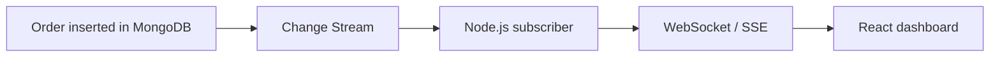

# Lesson 84 — Change Streams Introduction

[← Section 9](./README.md) · [Full curriculum](../README.md)

## 1. The problem: how does the server know something changed?

Suppose an admin dashboard should show a new order as soon as it is placed. One approach is to poll MongoDB every two seconds:

```js
setInterval(async () => {
  const latest = await Order.find().sort({ createdAt: -1 }).limit(5);
  // Compare against the previous result...
}, 2000);
```

Polling is simple but introduces delay and repeated database queries even when nothing changes. It also needs careful overlap handling, error handling, and state comparison.

**MongoDB Change Streams** let an application subscribe to a stream of database change events. The database informs the application when relevant inserts, updates, deletes and other supported changes occur.

Change streams are useful for notifications, cache invalidation, search indexing, activity feeds, audit pipelines and live dashboards. They are **not** a replacement for durable job queues or a complete event-driven architecture.

## 2. Mental model: MongoDB → backend → browser



A change stream is a **server-side subscription**. Browsers should not connect directly to MongoDB with database credentials. Your Node.js backend observes changes, applies authorization and filtering, then publishes appropriate events to clients.

## 3. Requirements and limitations

Change streams require a supported MongoDB deployment, generally a **replica set or sharded cluster**. A standalone MongoDB server does not provide normal change-stream support. Atlas clusters use a supported topology.

Change streams build on MongoDB's replication machinery and change history. They are **not a permanent event archive**: the underlying oplog/change history is bounded, and a consumer that is offline too long may be unable to resume from an old token.

Change streams can watch a collection, database, or deployment (depending on permissions and API). Their events describe committed changes; they are not emitted for an aborted transaction's uncommitted writes.

## 4. First Mongoose watch example

```js
import "dotenv/config";
import mongoose from "mongoose";

await mongoose.connect(process.env.MONGODB_URI);

const orderSchema = new mongoose.Schema({
  userId: mongoose.Schema.Types.ObjectId,
  status: String,
  totalMinor: Number
}, { timestamps: true });

const Order = mongoose.model("ChangeStreamDemoOrder", orderSchema);

const stream = Order.watch([
  { $match: { operationType: { $in: ["insert", "update", "replace"] } } }
]);

stream.on("change", change => {
  console.log("Change type:", change.operationType);
  console.log("Document ID:", change.documentKey?._id?.toString());
});

stream.on("error", error => {
  console.error("Change stream error:", error.message);
});

console.log("Watching order changes...");
```

Run the subscriber and insert/update an order from another terminal or process. The watcher prints events as MongoDB emits them. The watcher must remain running; unlike a normal `find()`, `watch()` creates a long-lived cursor.

## 5. What is inside a change event?

An insert event may resemble:

```json
{
  "_id": { "_data": "opaque-resume-token" },
  "operationType": "insert",
  "ns": { "db": "shop_api", "coll": "orders" },
  "documentKey": { "_id": "..." },
  "fullDocument": { "status": "PENDING", "totalMinor": 49900 }
}
```

The `_id` field of the **event** is a resume token; it is **not** the inserted document's `_id`. The inserted document ID is generally in `documentKey._id`.

For update events, `updateDescription.updatedFields` can show changed fields. A full post-update document is not always present by default. You may request `fullDocument:"updateLookup"`, but that lookup can observe a later version of the document if more updates occur before the lookup; it is not an immutable snapshot of the exact update event.

## 6. Filter the stream to reduce unnecessary work

```js
const stream = Order.watch([
  { $match: { operationType: "insert" } }
]);
```

The `$match` stage filters events. A real subscriber may also filter on namespace, status or other event fields. Understand the event shape before writing predicates; `fullDocument` may be absent for some operation types.

Do not modify or remove the event resume token with an aggregation pipeline projection if you intend to resume reliably.

## 7. Resume tokens: continue after a disconnect

A stream provides a resume token. A durable consumer should save the **last successfully processed** token to persistent storage.

```js
let lastProcessedToken; // Demo only: lost on restart

const stream = Order.watch();

stream.on("change", async change => {
  // Process event (make handler idempotent).
  console.log(change.operationType);

  lastProcessedToken = change._id;
  // Production: persist token only after successful processing.
});
```

On restart, a stream can be opened with `resumeAfter` when a valid saved token is available:

```js
const stream = Order.watch([], {
  resumeAfter: savedResumeToken
});
```

The token is **opaque**; store and reuse it without modifying it. Resume behavior depends on retained change history and stream invalidation. Some invalidation cases require `startAfter` instead. If the history has expired, rebuild state from a snapshot/reconciliation process rather than assuming no events were missed.

### Important ordering problem

If several async event handlers run concurrently and you save the token from a later event before an earlier event finishes, a crash can cause the earlier event to be skipped after restart. Production consumers should coordinate processing and checkpointing, for example by using a controlled sequential consumption loop.

## 8. A safer async iterator pattern

```js
async function consumeOrderChanges({ resumeAfter } = {}) {
  const stream = Order.watch([], resumeAfter ? { resumeAfter } : {});
  try {
    for await (const change of stream) {
      await processOrderEventIdempotently(change);
      await saveResumeTokenDurably(change._id);
    }
  } finally {
    await stream.close();
  }
}
```

The functions `processOrderEventIdempotently` and `saveResumeTokenDurably` are application-specific and must be implemented. If event processing and checkpoint storage are in separate systems, there is still a crash window; use idempotency/deduplication to handle replay.

A production runner needs restart logic, exponential backoff for transient failures, metrics, shutdown handling and a recovery strategy for expired tokens.

## 9. Example: live admin dashboard with Server-Sent Events

The backend can push sanitized order summaries over SSE:

```js
// Illustration only: for one server instance, with an existing event emitter.
import { EventEmitter } from "node:events";
export const orderEvents = new EventEmitter();

export function dashboardEvents(req, res) {
  // Must run behind requireAuth + requireRole("ADMIN")
  res.setHeader("Content-Type", "text/event-stream");
  res.setHeader("Cache-Control", "no-cache");
  res.flushHeaders();

  const send = payload => res.write(`event: order\\ndata: \${JSON.stringify(payload)}\\n\\n`);
  orderEvents.on("order", send);
  req.on("close", () => orderEvents.off("order", send));
}
```

A change-stream consumer can emit:

```js
orderEvents.emit("order", {
  type: "ORDER_CREATED",
  orderId: String(change.documentKey._id)
});
```

**Important:** This is a teaching example, not a complete distributed real-time service. A local `EventEmitter` only reaches clients connected to the **same Node.js process**. Multiple app instances require shared fan-out (for example Redis pub/sub or a message broker), and clients need reconnection and missed-event recovery. Protect SSE endpoints with authentication and authorization; never broadcast private order details to all users.

## 10. Change streams vs polling vs queues

| Mechanism | Strength | Limitation |
| --- | --- | --- |
| Polling | Simple, widely compatible | Repeated queries, delay |
| Change stream | React to database changes | Resume history is bounded; consumer lifecycle |
| Queue | Durable work delivery with retries, depending on system | Additional infrastructure and operational design |
| Transactional outbox | Persist event intent with business data | Requires reliable dispatcher and idempotent consumers |

A change stream can drive an outbox dispatcher, but it should not be treated as a guaranteed forever-retained message queue. For critical payments, use a durable workflow and reconcile state.

## 11. Exercises

1. Start a change stream and insert, update and delete a demo order. Observe event types and `documentKey`.
2. Compare an update event with and without `fullDocument:"updateLookup"`.
3. Store a resume token, stop the subscriber, restart it and resume.
4. Build an admin-only SSE endpoint and connect from a simple browser client.
5. Explain what happens if a subscriber is offline beyond the retained oplog history.
6. Describe why a consumer must be idempotent even when resume tokens are used.

## 12. Interview questions

**Q: Do change streams work on a standalone mongod?** Normally no; they require a replica set or sharded deployment.

**Q: Is a change stream a message queue?** No; change history is bounded and application processing/retry semantics are your responsibility.

**Q: What is a resume token?** An opaque checkpoint used to resume a stream from a prior event.

**Q: Why can an update's fullDocument differ from the precise event moment?** `updateLookup` can fetch a later document version.

**Q: Can a browser safely watch MongoDB directly?** No; a trusted backend should subscribe and publish authorized events.

**Official references:** [MongoDB change streams](https://www.mongodb.com/docs/manual/changeStreams/) · [Mongoose change streams](https://mongoosejs.com/docs/change-streams.html) · [MongoDB resume tokens](https://www.mongodb.com/docs/manual/changeStreams/#resume-a-change-stream)
